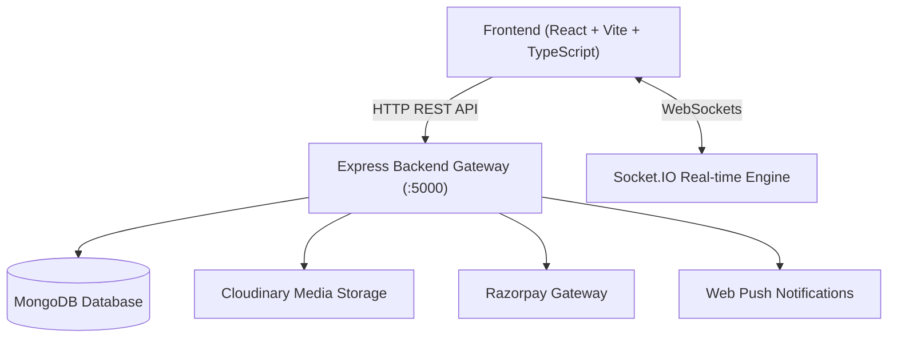

# 🚀 HIREWORK Freelance Marketplace

[](https://nodejs.org/)
[](https://opensource.org/licenses/MIT)
[]()

A modern, full-stack Freelance Marketplace Platform with Milestone Tracking, Gig Management, Escrow Protection, Real-Time Chat, Dispute Resolution, and AI Integration.

> [!TIP]
> **New to the project?** Follow the comprehensive step-by-step guide in [HOW_TO_RUN.md](HOW_TO_RUN.md) or [HOW_TO_RUN.txt](HOW_TO_RUN.txt) for detailed setup and run instructions.

---

## 📑 Table of Contents

- [Quick Start Guide](#-quick-start-local-development)
- [Demo Login Accounts](#-demo-login-accounts)

- [Features](#-features)
- [Tech Stack](#-tech-stack)
- [System Architecture](#-system-architecture)
- [Quick Start (Local Development)](#-quick-start-local-development)
- [Production Deployment](#-production-deployment)
  - [Docker & Docker Compose](#option-1-docker--docker-compose-recommended)
  - [Traditional Node.js / VPS / Cloud](#option-2-cloud-platforms-render--railway--vps)
- [Environment Variables Guide](#-environment-variables-guide)
- [Project Structure](#-project-structure)
- [Scripts Reference](#-scripts-reference)
- [Security & Production Hardening](#-security--production-hardening)
- [License](#-license)

---

## ✨ Features

- **Gig & Project Marketplace**: Create, search, filter, and apply for gigs or post client projects.
- **Milestone Tracking & Contracts**: Multi-stage milestone workflows with escrow deposit and release logic.
- **Real-Time Communication**: WebSocket-powered live messaging (Socket.IO) with outside-communication policy guardrails.
- **Payment & Escrow Integration**: Razorpay escrow payments and secure transaction verification.
- **Identity & Verification**: Portfolio showcases, KYC document uploads, and trust score calculations.
- **AI-Powered Assistance**: Integrated AI assistants for project scoping and proposal reviews.
- **Admin Dashboard**: Manage disputes, users, verifications, platform fees, and system analytics.
- **Progressive Web App & Push Notifications**: Web Push API support for instant updates.

---

## 🛠️ Tech Stack

- **Backend**: Node.js, Express.js (REST API, WebSockets via Socket.IO, Helmet, Compression, Rate Limiting)
- **Frontend**: React 19, TypeScript, Vite, Tailwind CSS, Lucide Icons, Framer Motion
- **Database**: MongoDB (Mongoose ORM) with local NeDB fallback support
- **Storage & Assets**: Cloudinary / Local storage with secure access middleware
- **Authentication**: JWT (JSON Web Tokens), Google OAuth2, bcryptjs

---

## 🏗️ System Architecture



---

## ⚡ Quick Start (Local Development)

### Prerequisites

- [Node.js](https://nodejs.org/) `>= 20.0.0`
- [npm](https://www.npmjs.com/) `>= 10.0.0`
- [MongoDB](https://www.mongodb.com/try/download/community) running locally on port `27017`

### 1. Extract ZIP & Open Terminal

Extract the ZIP archive and open a terminal in the project directory:

```bash
cd hirework-freelance-marketplace
```

### 2. Configure Environment Files

Copy the example environment files:

```bash
# Backend configuration
cp backend/.env.example backend/.env

# Frontend configuration
cp frontend/.env.example frontend/.env
```

Edit `backend/.env` with your preferred settings:
```ini
NODE_ENV=development
PORT=5000
MONGO_URI=mongodb://127.0.0.1:27017/HIREWORK
JWT_SECRET=your_secret_key_at_least_32_characters_long
CLIENT_URL=http://localhost:5173
ENABLE_SOCKET_IO=true
```

### 3. Install Dependencies

```bash
npm run install:all
```

### 4. Seed Sample Data (Users, Projects, Gigs)

```bash
npm run seed
```

### 5. Run Development Servers

Run backend and frontend concurrently:

```bash
npm run dev
```

Or in separate terminals:
```bash
# Terminal 1: Backend API (port 5000)
npm run server

# Terminal 2: Frontend client (port 5173)
npm run client
```

Open `http://localhost:5173` in your browser.

---

## 🔑 Demo Login Accounts

On the `/login` page, you can use the **1-Click Demo Login** buttons:

| Role | Email | Password | What You Can Test |
|---|---|---|---|
| **Client** | `client@hirework.com` | `Password@123` | Post projects, hire talent, milestone escrow |
| **Freelancer** | `freelancer@hirework.com` | `Password@123` | Submit proposals, create gigs, live chat |
| **Admin** | `admin@hirework.com` | `Password@123` | KYC verification, dispute resolution, analytics |

---

## 🚀 Production Deployment

### Option 1: Docker & Docker Compose (Recommended)

The repository includes a production-ready, multi-stage `Dockerfile` and `docker-compose.yml`.

1. Run the entire stack (App + MongoDB):
   ```bash
   docker-compose up -d --build
   ```

2. Access the live platform at `http://localhost:5000`.

### Option 2: Cloud Platforms (Render / Railway / VPS / Heroku)

1. **Build Step:**
   ```bash
   npm run build
   ```
   This automatically installs all dependencies and builds the production React application into `frontend/dist`.

2. **Start Step:**
   ```bash
   npm start
   ```
   The Node.js server automatically serves both the `/api/*` routes and the static compiled frontend from `frontend/dist` on port `5000`.

---

## 🔐 Environment Variables Guide

### Backend (`backend/.env`)

| Variable | Required | Description |
| :--- | :---: | :--- |
| `NODE_ENV` | Yes | Set to `production` or `development` |
| `PORT` | Yes | HTTP server port (e.g. `5000`) |
| `MONGO_URI` | Yes | MongoDB connection string (e.g. MongoDB Atlas URI) |
| `JWT_SECRET` | Yes | Secret key for signing authentication tokens (32+ chars) |
| `CLIENT_URL` | Yes | Allowed origin for CORS and web links |
| `ENABLE_SOCKET_IO` | No | Enables real-time chat (`true`/`false`) |
| `SMTP_HOST`, `SMTP_PORT` | No | SMTP mail server for notifications and OTP |
| `SMTP_USER`, `SMTP_PASS` | No | SMTP credentials |
| `GOOGLE_CLIENT_ID` | No | Google OAuth 2.0 Client ID for social auth |
| `GOOGLE_CLIENT_SECRET` | No | Google OAuth 2.0 Client Secret |
| `RAZORPAY_KEY_ID` | No | Razorpay API Key ID |
| `RAZORPAY_KEY_SECRET` | No | Razorpay API Secret |
| `CLOUDINARY_CLOUD_NAME` | No | Cloudinary cloud name for media storage |
| `CLOUDINARY_API_KEY` | No | Cloudinary API Key |
| `CLOUDINARY_API_SECRET` | No | Cloudinary API Secret |
| `VAPID_PUBLIC_KEY` | No | Web Push public key |
| `VAPID_PRIVATE_KEY` | No | Web Push private key |

### Frontend (`frontend/.env`)

| Variable | Required | Description |
| :--- | :---: | :--- |
| `VITE_API_URL` | No | Backend base URL (leave blank if served from same origin) |
| `VITE_GOOGLE_CLIENT_ID`| No | Google OAuth Client ID for frontend button |
| `VITE_VAPID_PUBLIC_KEY`| No | Web Push public VAPID key |

---

## 📁 Project Structure

```
freelance-marketplace/
├── backend/
│   ├── controllers/      # REST API route handlers
│   ├── data/             # Local database storage & fallbacks
│   ├── middleware/       # Auth, rate limiting, validation, error handling
│   ├── models/           # Mongoose schemas (User, Gig, Project, Contract...)
│   ├── routes/           # Express router endpoints
│   ├── scripts/          # Health monitoring and database migrations
│   ├── uploads/          # Local media upload folder
│   ├── utils/            # Helper utilities (Email, AI, trust score...)
│   ├── .env.example      # Backend environment blueprint
│   ├── index.js          # Server entry point & static SPA server
│   ├── package.json      # Backend dependencies & scripts
│   └── socket.js         # Socket.IO WebSocket implementation
├── frontend/
│   ├── public/           # Static assets, favicon, service worker
│   ├── src/
│   │   ├── components/   # Reusable UI widgets & modals
│   │   ├── context/      # Auth, Call, and Socket React contexts
│   │   ├── pages/        # Marketplace, Chat, Admin, Dashboard views
│   │   ├── App.tsx       # Main router & layout shell
│   │   └── main.tsx      # React DOM bootstrap
│   ├── .env.example      # Frontend environment blueprint
│   ├── index.html        # Single-page application root
│   ├── package.json      # Frontend dependencies & scripts
│   └── vite.config.ts    # Vite bundler configuration
├── Dockerfile            # Multi-stage production container build
├── docker-compose.yml    # App + MongoDB orchestration
├── package.json          # Root orchestration scripts
└── README.md             # Project documentation
```

---

## 📜 Scripts Reference

Run these commands from the root directory:

| Script | Command | Purpose |
| :--- | :--- | :--- |
| `npm run install:all` | Installs dependencies for both `backend` and `frontend` |
| `npm run build` | Full production build (installs deps and compiles frontend) |
| `npm run start` | Starts the production backend server |
| `npm run server` | Starts the backend in development mode with nodemon |
| `npm run client` | Starts the Vite frontend dev server |

---

## 🛡️ Security & Production Hardening

- **Helmet & CSP**: Configured with Content Security Policy headers for payment and auth scripts.
- **Rate Limiting**: IP-based rate limiting on sensitive authentication and payment endpoints.
- **XSS & Injection Protection**: Request validation and mongo-sanitize middlewares.
- **CORS Protection**: Whitelisted origin matching against configured `CLIENT_URL`.
- **JWT & Password Hashing**: Passwords hashed with bcrypt (salt rounds: 10), token expiration policies.

---

## 📄 License

This project is licensed under the [MIT License](LICENSE).
